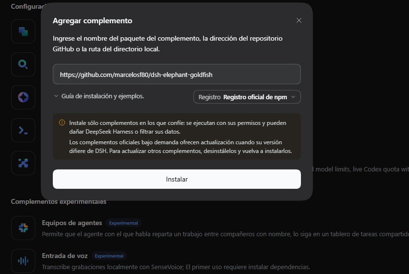
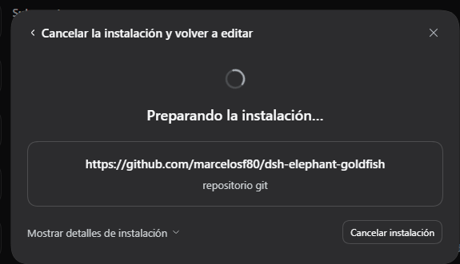
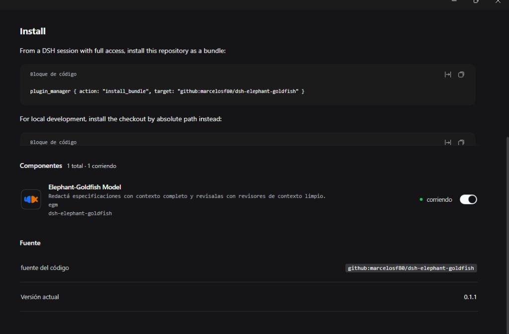
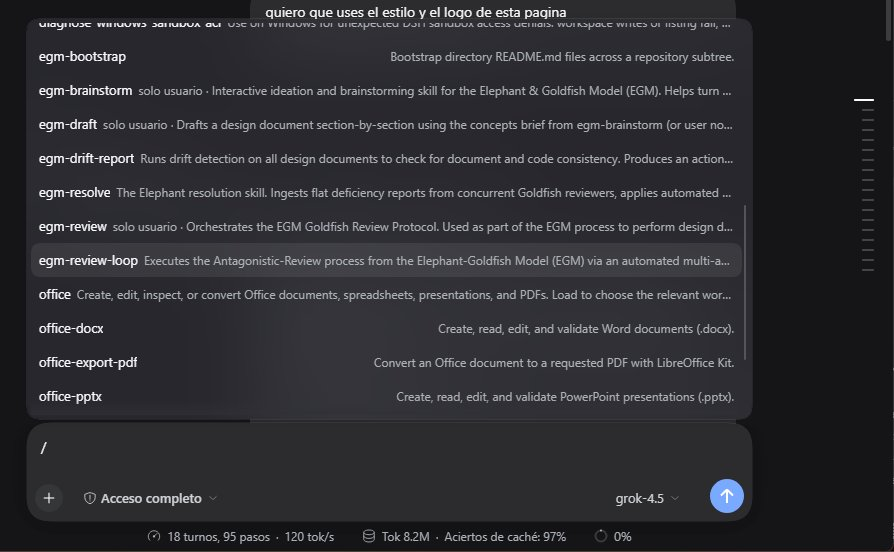

# dsh-elephant-goldfish

  

  <strong>The Elephant-Goldfish Model (EGM) ported to DeepSeek Harness (DSH)</strong> 
  Draft specifications with full project context, then review them with fresh, unbiased reviewers.

  
  
  
  

---

The [Elephant-Goldfish Model](https://github.com/google/elephant-goldfish-model) (EGM) as a DeepSeek Harness plugin. You draft a specification with your project context in hand, then independent reviewers read it with fresh context and without earlier conversation bias, so unstated assumptions and blind spots surface before implementation starts.

This package ports EGM's seven skills, ten reviewer personas, and five document standards to DSH. The skill text is upstream EGM; the port adds the harness mapping, the skill provider, and the display metadata.

> 📖 **Documentación en español:** Consulte la guía completa paso a paso en [docs/GUIA-USO.md](docs/GUIA-USO.md).

---

## Visual Walkthrough / Ejemplos de Uso

<table width="100%">
  <tr>
    <td width="50%" align="center"><strong>1. Agregar complemento en DSH</strong></td>
    <td width="50%" align="center"><strong>2. Instalación en curso</strong></td>
  </tr>
  <tr>
    <td align="center"></td>
    <td align="center"></td>
  </tr>
  <tr>
    <td width="50%" align="center"><strong>3. Plugin activo y verificado</strong></td>
    <td width="50%" align="center"><strong>4. Comandos EGM disponibles (/egm-*)</strong></td>
  </tr>
  <tr>
    <td align="center"></td>
    <td align="center"></td>
  </tr>
</table>

---

## Install

### From DSH GUI
1. Open **Settings** > **Add plugin** (Agregar complemento).
2. Enter the repository URL:
   `	ext
   https://github.com/marcelosf80/dsh-elephant-goldfish
   `
3. Click **Install** (Instalar).

### From a DSH Session (Full Access)
Install this repository directly as a bundle:

`	ext
plugin_manager { action: "install_bundle", target: "github:marcelosf80/dsh-elephant-goldfish" }
`

For local development, install the checkout by absolute path instead:

`	ext
plugin_manager { action: "install_bundle", target: "<absolute path to this checkout>" }
`

The bundle registers one Host row, egm, which publishes the seven skills through the ctx.skills registry. It installs nothing outside this package and writes nothing into ~/.dsh/skills. Changes affect every session in the profile and survive restart; remove it with plugin_manager { action: "remove_bundle", target: "dsh-elephant-goldfish" }.

**Updating a GitHub install:** re-run install_bundle with the same target after pushing a new commit, then restart the Harness if the lib/ code changed (a body-only skill edit needs no restart, because bodies are re-read on load). Switching a profile between a local link and the GitHub source always needs one Harness restart: the running process keeps the module generation it imported.

---

## Skills & Slash Commands

Start an EGM skill directly from the message box (/name injection), or load a model-invocable skill with the skill tool:

| Skill | Trigger / Command | Purpose |
| :--- | :--- | :--- |
| egm-brainstorm | /egm-brainstorm <idea> | Explore an idea with fresh reviewers; output concepts_brief.md. |
| egm-draft | /egm-draft | Turn the brief into design_draft.md, section by section. |
| egm-review | /egm-review <design_draft.md> | Five-stage Goldfish review protocol with per-stage reports. |
| egm-resolve | /egm-resolve or skill | Work through findings and agree on edits. |
| egm-review-loop | /egm-review-loop or skill | Run a selected group of reviewers for a specific task. |
| egm-bootstrap | /egm-bootstrap or skill | Document an existing codebase from scratch. |
| egm-drift-report | /egm-drift-report or skill | Compare checked-in documents with current code. |

The three entry skills keep EGM's disable-model-invocation: true: the model never starts a review on its own, you do. The four supporting skills are model-invocable so a running skill can load them in the same thread.

**Bundled Reviewers:** zoom_out, inventive_catalyst, comprehension, design_critic, structural, style, implementation_readiness, codebase_details, and synthesizer, plus the ootstrap_orchestrator. EGM runs each reviewer in a fresh subagent context. In DSH that is the subagent tool with the persona file plus absolute paths in the prompt; subagent_fork inherits the conversation and is not a Goldfish.

Read [docs/dsh.md](docs/dsh.md) for the full harness mapping: delegation template, question gates, artifact directory, and the isolation limits of this port.

---

## What is in the package

45 files. The runtime content is upstream EGM plus one host guide and one Host plugin.

| Path | Role |
| :--- | :--- |
| lib/index.js | Host plugin: registers the egm skill provider and substitutes the installed root into skill bodies. |
| cordis.patch.yml | Bundle patch: one egm row. |
| skills/egm-*/ | The seven skills, with per-skill 
eferences/ and icons. |
| gents/*.md | Ten reviewer and orchestrator personas, upstream text. |
| 
esources/document_standards/ | The standards reviewers apply. |
| docs/dsh.md | DSH integration guide (the only DSH-specific document). |
| docs/images/ | Visual guides and interface walkthrough screenshots. |
| locale/en.json, locale/es.json, icon.svg | Plugin Manager metadata and artwork. |

Root resolution: skill bodies address shipped material as {{EGM_ROOT}}/agents/.... The provider replaces that token with its own installed package directory on load, so no path is hardcoded and a profile or version move does not break the text. Paths the user owns, such as docs/designs/, stay relative to the session working directory.

---

## Changes to the upstream text

Limited to the harness mapping; the review protocol, personas, and standards are otherwise byte-identical to EGM 0.1.1 (see NOTICE):

1. One preamble line per skill replaces the two upstream harness-pointer lines (Codex/Claude guides) with a pointer to docs/dsh.md.
2. DeepSeek Harness: subagent added to the delegation tool list.
3. The docs/harnesses.md link became {{EGM_ROOT}}/docs/dsh.md.
4. The four supporting skills lost disable-model-invocation: true so they can be loaded in-thread; the three entry skills keep it.
5. Claude/Codex command forms (/egm:egm-draft, "host's command form") became the DSH form (/egm-draft, or the skill picker).
6. sk_question became sk_user_question, the tool this harness actually exposes.
7. egm-bootstrap gained one sentence at Step 4: on DSH the scout reads happen inline because a spawned worker cannot delegate. egm-brainstorm Step 2 gained the same direct-dispatch note in place of the synthesizer path.

---

## Verification

Installation, live catalog evidence, the body-size probe, the ask-user schema check, and the end-to-end two-reviewer run are recorded in [VERIFICATION.md](VERIFICATION.md). Reproduce the offline checks with the commands under [Development](#development).

---

## Known limits

- **Delegation depth is 1.** DSH caps delegation at one level by default (subagent.maxDepth starts at 1), so a spawned child cannot spawn. EGM's flows therefore dispatch reviewers from the main context; egm-synthesizer is shipped but is only a prompt shape here, and egm-bootstrap workers read their scout input inline.
- Reviewer read-only behavior is an instruction to the subagent, not a host-enforced tool allowlist.
- A fresh DSH subagent has no parent conversation turns, but the session's instruction files may still reach it. EGM documents this kind of leak for other harnesses too; treat it as an open isolation gap.
- Skill bodies are loaded in full. DSH does not cap loaded instruction bodies, so egm-review (about 24 KB) costs real context when loaded.
- Named personas are not a native DSH concept. A future revision could register each persona as an Agent Preset and expose an gent_preset enum through a Host 	ool-subagent row; this bundle uses the EGM-documented general-purpose fallback instead, which is what the verification run covers.

---

## Development

`ash
node tools/test-provider.mjs        # provider contract: names, policy, bodies, root substitution
node tools/check-shipped-files.mjs  # every shipped-material path a skill names resolves
node tools/adapt-skills*.mjs        # idempotent adapters to re-apply after re-copying upstream skills
`

CI runs the first two on every push (.github/workflows/checks.yml). To port a newer EGM release, replace skills/, gents/, and 
esources/ from the upstream repository, re-run 	ools/adapt-skills.mjs and 	ools/adapt-skills-pass2.mjs (both fail loudly if upstream text changed), then 
ode tools/adapt-skills-pass3.mjs to assert no harness-specific residue remains.

---

## License

Apache-2.0. The EGM skills, personas, standards, and icon are Copyright 2026 Google LLC, from the upstream repository, with the local changes listed in [NOTICE](NOTICE). This bundle is an unofficial port, not an officially supported Google product.